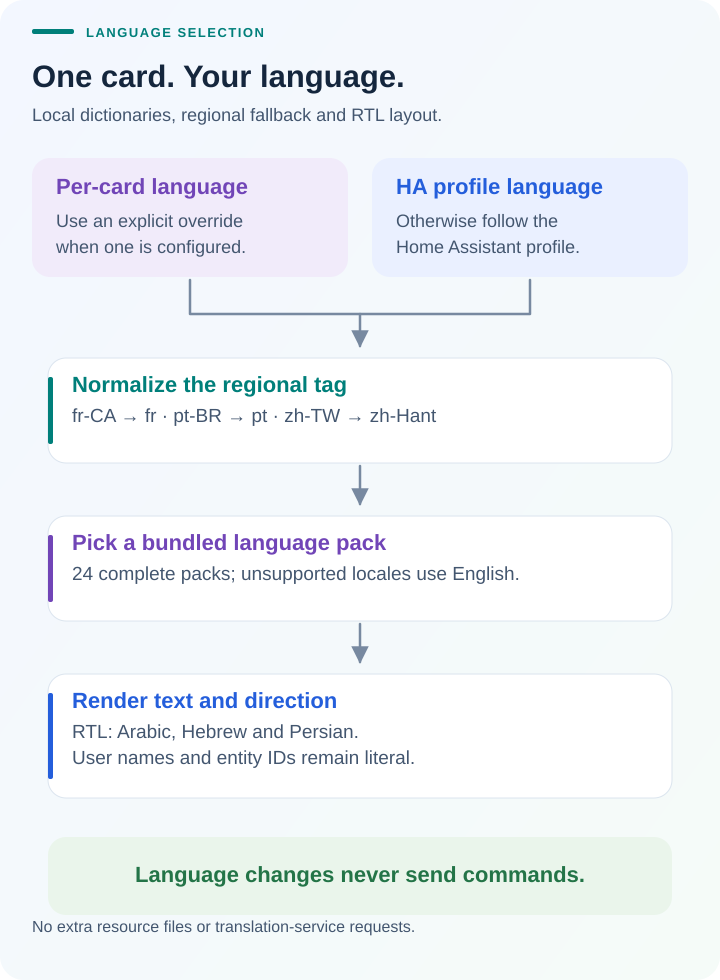

# How the DESLOC Lock Card works

The card is a frontend for standard Home Assistant lock entities and optional
battery/Wi-Fi sensors. Account authentication, device discovery, and cloud
communication belong to the [DESLOC integration](https://github.com/ha-homelab/ha-desloc#architecture).
The card itself never receives DESLOC credentials or contacts the vendor cloud.

## Two layouts, one installation

The full card and compact card share the same renderer, editor, and command
handling in `ha-desloc-card.js`. The `compact` setting changes their presentation
and suggested dashboard size. It never triggers a service call.

Existing `custom:desloc-lock-card` configurations keep the full layout unless
`compact: true` is set. The `custom:desloc-compact-lock-card` picker option starts
compact by default; an explicit `compact: false` switches it to the full layout.
Both offer the same state-dependent action and unlock confirmation. Optional
sensor readings remain available in the compact layout.

## From a click to the reported result

1. Read the configured HA entities. The visual editor selects one lock and
   optional sensors; missing readings remain unavailable instead of becoming
   zero. The card does not discover locks itself.
2. Use one persistent action button. It offers **Unlock** only for a reported
   locked state and **Lock** for an unlocked state. Unknown, jammed, and
   unrecognized states retain manual **Lock** recovery. Unavailable or missing
   entities disable the button; transitions and pending commands show localized
   progress and keep it disabled.
3. Ask for confirmation naming the selected lock. A configured name takes
   precedence over its current friendly name and then its entity ID. Cancelling
   sends no service call. The action is captured when a pointer or keyboard
   press begins; a state or target change before release cancels that activation.
4. Recheck the selected entity and allowed action after confirmation, then call
   HA's `lock.unlock` service once for that same entity. Cancel if the target or
   allowed action changed. The pending flag blocks duplicate clicks. **Lock**
   uses `lock.lock` without the Unlock confirmation prompt. The card never sends
   a generic toggle command or derives permission from the button's DOM state.
5. Render subsequent HA state or a localized command error. The card does not
   optimistically invent a successful result or automatically retry a command.

The card translates an allowlist of structured DESLOC error codes locally.
Unknown codes, other integrations, and arbitrary server messages use the generic
error. A recognized timeout or command-result error can clear when the same
entity later moves from an uncertain state to a stable report with a newer
`last_changed` timestamp. The card does not infer recovery from sensor updates,
elapsed time, or cached stable state. Authentication and availability errors
are not dismissed by that rule.

The integration determines how a service call reaches the device and how its
result is confirmed. For DESLOC this is a cloud path, so reported bolt state can
be cached and is not a door-open sensor. After an uncertain result, inspect the
physical lock before choosing another action.

## Language selection without extra requests

The card and visual editor contain 24 complete language packs in the single
shipped JavaScript file. By default they follow the HA profile. A **Language**
selection in the editor, or `language` in YAML, overrides the profile for one
card. Regional tags map to the appropriate pack; unsupported locales fall back
to English. Arabic, Persian, and Hebrew use right-to-left layout.

Translation applies to interface text, confirmation, and errors. It does not
change user-defined names, entity IDs, or readings. Names are inserted as text,
not interpreted as HTML. Changing language never sends a lock command. See the
[language guide](i18n.md) for pack names, fallback rules, and contributions.

## What the result provides

One installable JS file provides a visual editor, reported state and sensor
readings, lock controls, light/dark themes, and localized interaction. It has no
runtime package dependencies. The existing [screenshot walkthrough](screenshots.md)
shows the UI, while [release results](release-results.md) explain the checks
behind v0.2.0: 44 passing unit tests, 24 locales checked in three browser
engines, and two bounded fuzz targets.

The browser checks use synthetic HA state and stubbed service calls. They
establish frontend behavior, not physical device operation or compatibility
with every lock model. Keep those results separate from the integration's
[physical and community reports](https://github.com/ha-homelab/ha-desloc/blob/main/docs/compatibility.md).
