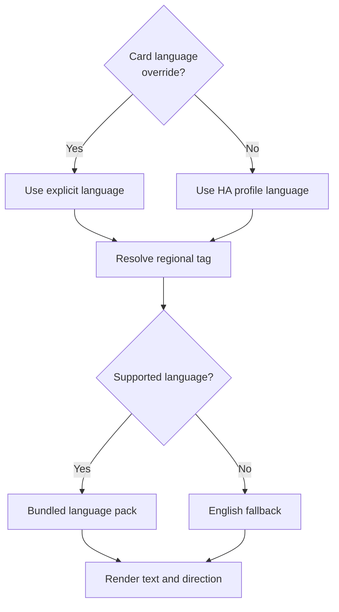

# Languages and translation contributions

The card includes 24 complete language packs: English, Arabic, Bengali, Czech,
German, Spanish, Persian, French, Hebrew, Hindi, Indonesian, Italian, Japanese,
Korean, Dutch, Polish, Portuguese, Russian, Thai, Turkish, Ukrainian, Vietnamese,
Simplified Chinese, and Traditional Chinese.

The default follows the Home Assistant profile language. The visual editor's
**Language** field can override it for one card. Choose **Use Home Assistant
language** to remove the override. YAML accepts the same language codes as
[`locales/index.json`](../locales/index.json), for example `language: fr`.
Regional tags such as `pt-BR`, `fr-CA`, and `zh-TW` resolve to the corresponding
pack. Unsupported languages fall back to English. Arabic, Persian, and Hebrew
use right-to-left layout. Numeric telemetry retains its direction and units.

The translated surface includes reported states, caption, telemetry labels,
commands, physical-unlock confirmation, command failure messages, configuration
validation, editor field labels, and the information button's accessibility
label. The card-picker description uses the browser language because the card
picker registers before Home Assistant supplies a profile. The product name
**DESLOC Lock Card** and user-provided names and entity IDs stay literal.



## Privacy and command safety

Every language is bundled into the same `ha-desloc-card.js` HACS asset. Switching
languages needs no download, browser storage, translation service, or additional
resource registration. No names, entity IDs, credentials, or telemetry are sent
to a translation service.

Changing the HA profile language only redraws text. Changing the editor's
language setting only updates the card configuration. Neither operation changes
entities, renames a lock, calls an HA service, retries a failed command, or clears
a pending-command gate. Unlock still requires a reported locked state and an
explicit confirmation in the selected language. The dialog includes the literal
displayed lock name. Confirming it sends the same single HA service call in every
language. Cancelling sends nothing.

Translations and interpolated values are rendered as text, never HTML. A lock
name containing braces or markup remains a literal name. Raw transport errors
are not displayed; the translated failure message tells the user to check the
physical lock before retrying.

## Improve a translation

1. Edit `locales/<code>.json`. English in `locales/en.json` defines the canonical
   keys. All packs must contain the same keys with nonempty values.
2. Preserve named placeholders exactly: `{name}`, `{value}`, and `{field}`.
   Use complete sentences and keep Home Assistant, Wi-Fi, units, and entity IDs
   recognizable. Review physical-unlock warnings especially carefully.
3. For a new language, add its native name and direction to `locales/index.json`
   and extend the supported-language assertion in `test/i18n.test.js`.
4. Regenerate the embedded dictionary and run the checks below. Commit both the
   source JSON and generated `ha-desloc-card.js`.

```sh
node scripts/build-i18n.mjs
node scripts/build-i18n.mjs --check
npm test
node fuzz/replay.mjs
python3 scripts/test_package_card.py
```

Normal installation requires no build step: the checked-in and release entry
points already include translations. The release packager stamps the planned
package version into that file without adding external imports. Under the
promote-bytes policy, an RC embeds the numeric base version (for example,
`0.2.0`); the candidate identity is recorded in the release manifest rather than
in the JavaScript version banner.

Automated checks cover key and placeholder parity, the generated bundle, all 24
languages, regional fallback, RTL, live language changes, hostile names, editor
configuration, and confirmation/pending-command boundaries using synthetic HA
state. They do not certify native-speaker wording or physical lock behavior.
Native-speaker corrections are welcome; include the language, screen, current
wording, suggested wording, and a fictional example rather than private data.
